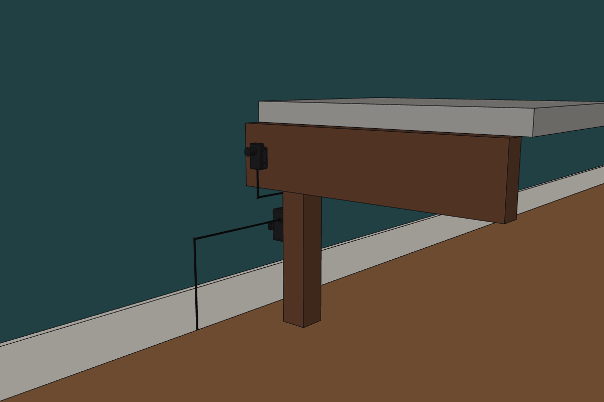

# BedLight

ESP8266 firmware that controls the LED strip behind my bed. You can dim the light with a rotary encoder on the device, or from Home Assistant, which discovers it automatically over MQTT.

## Hardware

- **Wemos D1 mini (ESP8266)**: the microcontroller, with its own 3.3 V regulator on the board.
- **LED strip**: a plain 12 V single-color strip on a 2-pin JST plug.
- **IRF3708 MOSFET (TO-220)**: switches the strip's negative side. It is fully on at 3.3 V gate drive, so the ESP drives it directly with PWM and it needs no heatsink.
- **USB-C Power Delivery board**: requests 12 V from a USB-C PD charger and powers everything.
- **Mini buck converter**: steps the 12 V down to 5 V for the D1 mini's `5V` pin.
- **2 × WAGO 221-413**: distribute +12 V and GND.
- **KY-040 rotary encoder with push button**: the local control, mounted on the bed frame.

```
USB-C PD charger
      │ 12 V
      ▼
 PD trigger board ──► WAGO +12 V ──┬──────────────► LED strip (+)
                                   │                LED strip (−) ──► IRF3708 drain
                                   └──► Buck 5 V ──► D1 mini 5V          │
                                                    D1 mini D1 ──PWM──► gate
                    WAGO GND ◄── buck GND, D1 mini GND, IRF3708 source ◄─┘
                                                    D1 mini D5/D6/D7 ◄── KY-040
```

### Pinout

| Function           | D1 mini pin | GPIO |
|--------------------|-------------|------|
| MOSFET gate (PWM)  | D1          | 5    |
| Encoder A (CLK)    | D6          | 12   |
| Encoder B (DT)     | D7          | 13   |
| Encoder button (SW)| D5          | 14   |
| Encoder +, GND     | 3V3, G      |      |

None of these pins has a special function at boot, and the UART stays free for flashing and logging.

### Enclosure

3D-printable parts (black PLA/PETG) are in [cad/](cad/): `BedLight_Gehaeuse.stl`, `BedLight_Deckel.stl` and `BedLight_Encoder_Abdeckung.stl`, plus a STEP file and the SolidCraft design with all dimensions as parameters.

- **Housing** (100 × 60 × 26 mm inside): snap-in cradles for the two WAGO 221-413, a screw boss for the IRF3708 tab (M3), rails for the buck converter (fix it with a drop of hot glue), and a seat for the D1 mini with its USB port reachable through the right wall. Cable slots on the left (12 V in) and at the back (LED and encoder); mounting tabs for 4 mm wood screws.
- **Lid**: 4 × M3 countersunk screws into the corner bosses.
- **Encoder cover**: slips over the KY-040 on the bed frame and is held by 4 wood screws (3.5 mm).

Print the housing and the encoder cover with the open side up or down as modeled (no supports needed), and the lid flat. Component sizes are standard values, so measure your WAGO clamps and KY-040 and adjust the parameters before printing if they differ.



### Planned hardware improvements

These need a perfboard and a few parts, so they are not built yet:

- [ ] **Gate pulldown**: 10 kΩ from gate to source, so the MOSFET stays off while the ESP boots, restarts or is flashed.
- [ ] **Gate resistor**: 100–220 Ω in series between D1 and the gate, against current spikes and ringing from the gate capacitance (~2.4 nF).
- [ ] **Bulk capacitors**: 470–1000 µF / 25 V on the 12 V input, and 220–470 µF / 10 V plus 100 nF on the D1 mini's 5 V pin, so Wi-Fi current spikes and supply glitches don't cause brownouts.
- [ ] **Buck converter**: set it to exactly 5.0 V before connecting the ESP and lock the trimmer with a drop of glue, or replace it with a fixed 5 V module. The D1 mini's regulator tolerates at most about 6 V.
- [ ] **Insulate the MOSFET tab**: it is connected to the drain (LED −).
- [ ] **Short wires** in the load path (12 V → strip → MOSFET → GND), and keep the D1 mini's antenna away from wires and metal.
- [ ] **Fuse**: optionally 2–3 A in the 12 V input.

## Controls

### Rotary encoder

| Action        | Effect                                                                      |
|---------------|-----------------------------------------------------------------------------|
| Turn          | Dims the light up or down, very finely near off.                            |
| Single click  | Turns the light off, or back on at the last brightness it had.              |
| Double click  | Publishes `1` to `bedroom/bedlight/button/doubleclick`.                     |
| Long press (1 s) | Publishes `1` to `bedroom/bedlight/button/longpress`.                    |

The double click and long press don't change the light directly. They show up as device triggers in Home Assistant, so you can use them in automations, such as switching other lights in the room.

### Fine dimming at the low end

Each detent changes the brightness by 10% of its current level, and by at least one step. The PWM runs at 10-bit resolution (0–1023), so:

- **Near off**, each detent moves a single step (0.1%), which gives very fine control in the dark.
- **Near full brightness**, each detent changes the brightness by about 10%.
- **Off to full** takes 64 detents. Turning faster just passes more detents, so there is no sudden jump.

You can set the step size with `DIM_STEP_PERCENT` in [include/config.h](include/config.h).

## Home Assistant

The light shows up in Home Assistant automatically through [MQTT discovery](https://www.home-assistant.io/integrations/mqtt/#mqtt-discovery). You don't need any YAML. You only need the MQTT integration set up in Home Assistant.

1. When the ESP connects to the broker, it publishes retained config messages under `homeassistant/...`. These describe the device: a dimmable light plus two button triggers.
2. Home Assistant reads them and creates a **Bed Light** device. Its ID comes from the ESP chip, so it is the same after every reboot.
3. Controlling the light from Home Assistant sends a command to the ESP. The ESP reports its brightness back, including when you turn the knob, so the dashboard always matches the real light.
4. A last-will message marks the light as *unavailable* if the ESP goes offline. When Home Assistant restarts, it announces `online` on `homeassistant/status`, and the ESP sends its discovery messages again.

The double click and long press show up as **device triggers**, so you can pick them in the automation editor under *Device → Bed Light*.

### Topics

| Topic                                 | Direction | Payload                                  |
|---------------------------------------|-----------|------------------------------------------|
| `bedroom/bedlight/set`                | in        | `ON` / `OFF`                             |
| `bedroom/bedlight/brightness/set`     | in        | `0`–`255`                                |
| `bedroom/bedlight/state`              | out       | `ON` / `OFF` (retained)                  |
| `bedroom/bedlight/brightness`         | out       | `1`–`255` (retained)                     |
| `bedroom/bedlight/status`             | out       | `online` / `offline` (retained, LWT)     |
| `bedroom/bedlight/info`               | out       | IP, RSSI, reset reason, disconnects, restarts (retained) |
| `bedroom/bedlight/button/doubleclick` | out       | `1`                                      |
| `bedroom/bedlight/button/longpress`   | out       | `1`                                      |
| `homeassistant/status`                | in        | `online` triggers a new discovery        |

Home Assistant brightness (0–255) is gamma-mapped onto the PWM range, so 50% in Home Assistant looks like half brightness.

The device connects to Wi-Fi without blocking startup, so the encoder works even when there is no network.

### Self-healing connection

Power glitches can leave the ESP8266 running (the encoder still works) while its radio stays disconnected for good. The firmware recovers on its own:

1. **MQTT drops**: it reconnects every 5 seconds. Connection attempts time out after 3 seconds, so the encoder never stalls.
2. **Wi-Fi stays down for 30 s**: it forces a fresh Wi-Fi connection, and repeats that every 30 s.
3. **No MQTT for 5 minutes**: it restarts the ESP, which also resets the radio. If that does not help, the wait doubles each time (5, 10, 20, 40, up to 60 minutes).

The light's state is kept in RTC memory across the restart, so the brightness stays the same. `bedroom/bedlight/info` reports Wi-Fi disconnects, the last disconnect reason and the number of watchdog restarts that were needed.

## Setup

1. Copy the secrets template and fill in your Wi-Fi and MQTT credentials. `include/secrets.h` is gitignored.
   ```bash
   cp include/secrets.h.example include/secrets.h
   ```
2. Build and flash with [PlatformIO](https://platformio.org):
   ```bash
   pio run -t upload
   ```
3. Optionally, watch the log output:
   ```bash
   pio device monitor
   ```

## Project layout

```
include/
  config.h               pins, topics, tuning values
  secrets.h.example      template for Wi-Fi/MQTT credentials
src/
  main.cpp               setup and main loop
  led.cpp                PWM brightness and on/off toggle
  input.cpp              rotary encoder and button handling
  mqtt.cpp               Wi-Fi, MQTT, Home Assistant discovery, self-healing
  persist.cpp            light state kept in RTC memory across restarts
```
